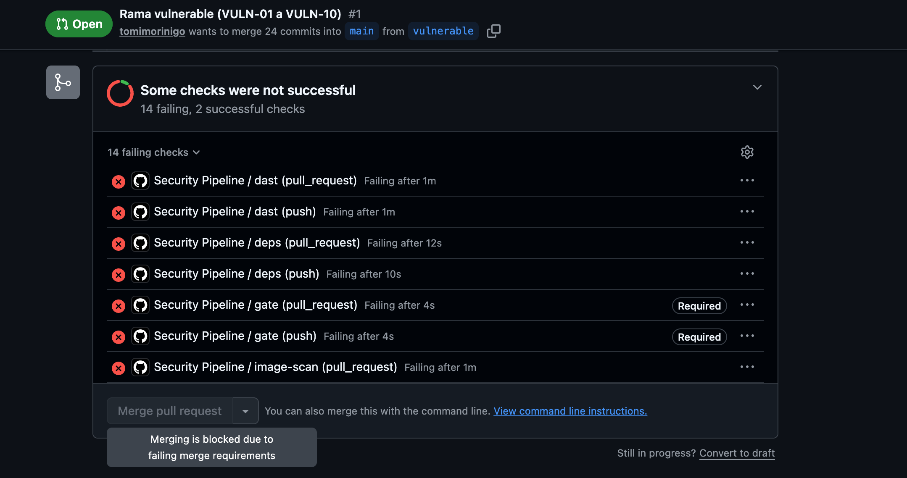
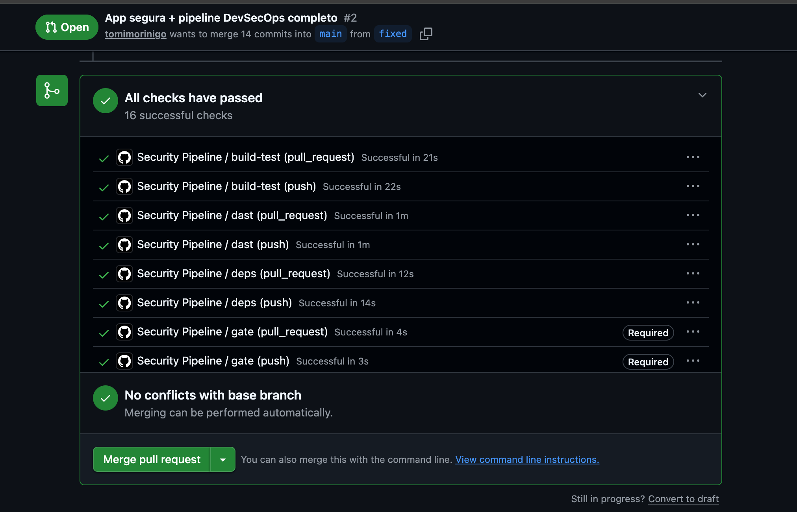
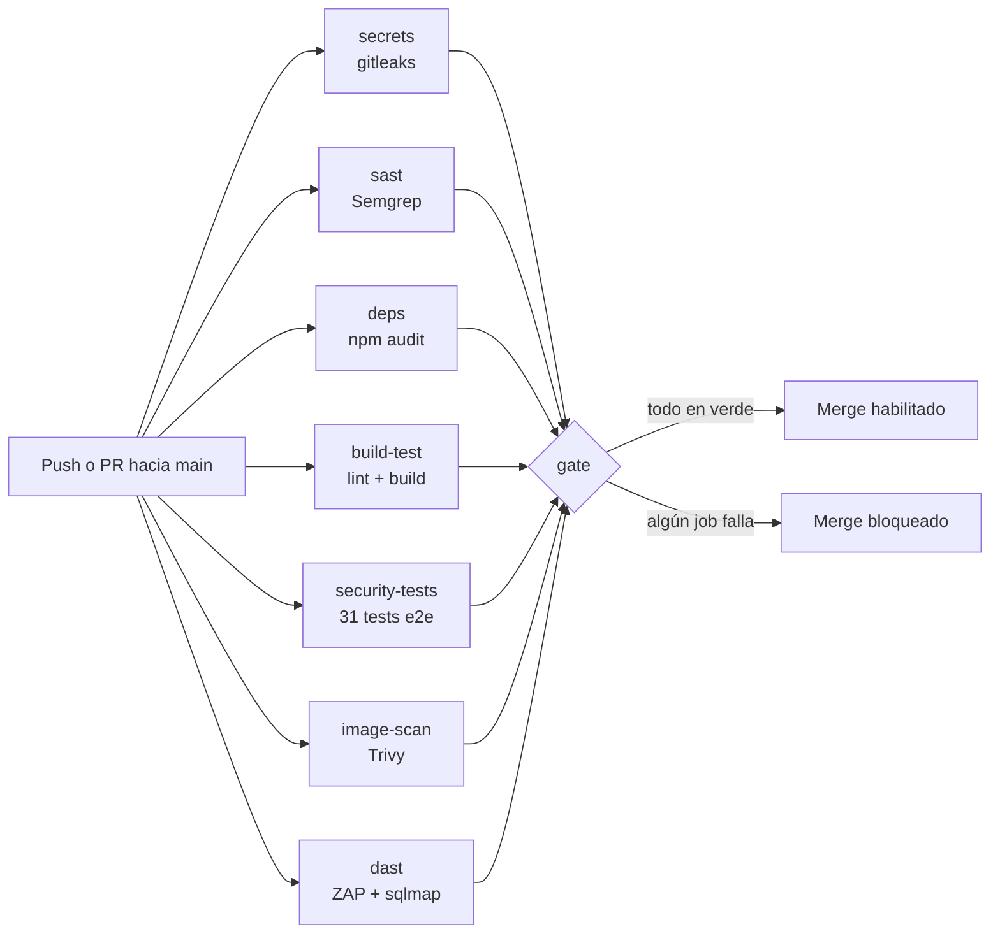
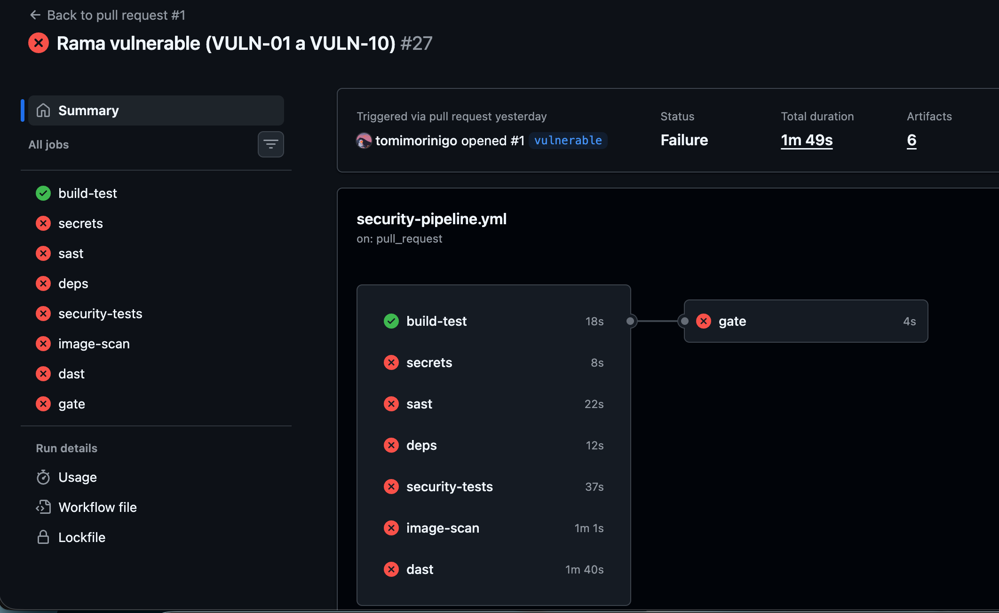

# Pipeline DevSecOps para la detección automática de vulnerabilidades web

**Seguridad en el Desarrollo de Software** — UTN FRC — Ingeniería en Sistemas de Información
**Comisión:** 4K3A — **Año:** 2026

| Integrante | Legajo |
|---|---|
| Fabrizio Torres | 94231 |
| Tomas Morinigo | 95639 |
| Gonzalo Majlis | 95047 |
| Francisco Ochoa | 96065 |

---

## En resumen

**Problema:** hoy una gran parte del código se escribe con asistentes y agentes de IA. Generan mucho código, muy rápido, y su objetivo es que **funcione**. Las decisiones de diseño de seguridad (parametrizar una consulta, validar quién es el dueño de un recurso, no desactivar la CSP, no dejar un secreto en el código) muchas veces no son parte de lo que se les pide ni de lo que verifican. Una persona revisando PRs no llega a ver todo, y menos al ritmo con que se genera el código.

**Propuesta:** un pipeline de GitHub Actions que analiza **cada cambio, sin importar quién o qué lo escribió**, con varias herramientas de seguridad, y **bloquea el merge a `main`** si alguna encuentra algo. Es una red de seguridad automática que no se cansa, no se saltea pasos y aplica el mismo criterio a una persona que a un agente.

**Cómo lo demostramos:** una misma app NestJS en dos ramas:

| Rama | Contenido | Resultado del pipeline |
|---|---|---|
| `fixed` | App segura, con cada control marcado como `// FIX-XX` | ✅ Todo en verde: [PR #2](https://github.com/tomimorinigo/devsecops-pipeline-nestjs/pull/2), merge habilitado |
| `vulnerable` | La misma app con **10 vulnerabilidades plantadas**, un commit por cada una (`// VULN-XX`) | ❌ 7 de 8 jobs en rojo: [PR #1](https://github.com/tomimorinigo/devsecops-pipeline-nestjs/pull/1), **merge bloqueado** |

| PR `vulnerable → main`: bloqueado | PR `fixed → main`: habilitado |
|---|---|
|  |  |

**Resultado principal:** las 10 vulnerabilidades fueron detectadas, pero **ninguna herramienta las detectó todas**. La que más cubrió fueron los tests escritos a mano (7/10), y los rulesets públicos de Semgrep no encontraron ninguna. Detalle completo en la [matriz de cobertura](docs/matriz-cobertura.md).

---

## El pipeline

Cada push y cada PR hacia `main` disparan el workflow [`security-pipeline.yml`](.github/workflows/security-pipeline.yml). Los jobs de análisis corren en paralelo y el job `gate` junta todos los resultados. Una regla de protección de la rama (ruleset `protect-main`) exige que `gate` pase para poder mergear, **sin excepciones ni para administradores**.



| Etapa | Herramienta | Qué busca | Rompe el build si… |
|---|---|---|---|
| Secretos | **gitleaks** + regla propia | Credenciales en todo el historial de Git | Encuentra cualquier secreto |
| SAST | **Semgrep**: 5 reglas propias + `p/owasp-top-ten` | Patrones inseguros en el código y las plantillas | Hay hallazgos de severidad ERROR |
| Dependencias | **npm audit** + Dependabot | CVEs en dependencias de producción | Hay avisos HIGH o CRITICAL |
| Imagen | **Trivy** | CVEs del sistema operativo y de `node_modules` en la imagen, y errores de configuración del Dockerfile | Hay CVEs HIGH/CRITICAL con fix, o la imagen corre como root |
| Tests de seguridad | **Vitest + supertest** contra Postgres | IDOR, SQLi, XSS, headers/CSP, CORS y sesiones | Falla cualquier test |
| DAST | **ZAP** (pasivo + activo acotado) y **sqlmap** | XSS, SQLi y headers, contra la app levantada en el CI | ZAP: alerta MEDIUM o mayor. sqlmap: cualquier inyección |
| Gate | `jq` sobre los resultados | — | Falló cualquier job anterior |

El pipeline completo tarda **menos de 2 minutos**. Cada job publica su reporte como artifact y el `gate` escribe un resumen en la corrida. Los umbrales y su justificación están en [umbrales.md](docs/umbrales.md).

**Prácticas DevSecOps aplicadas al propio pipeline:**
- Actions pineadas por SHA, no por tag: un tag se puede mover, un SHA no.
- `permissions: contents: read` por defecto.
- Imágenes de las herramientas con versión fija.
- Secretos de prueba generados al azar en cada corrida, sin ninguno guardado en el repo ni en GitHub.

---

## Las 10 vulnerabilidades

| ID | Vulnerabilidad | Tema de la materia | Lo detecta |
|---|---|---|---|
| VULN-01 | SQL injection en el buscador de productos | Inyección / SQLMap | Semgrep (propia), tests, ZAP, sqlmap |
| VULN-02 | IDOR: cualquier usuario lee las notas de otro | Control de acceso | **Solo los tests** |
| VULN-03 | XSS reflejado en la página de búsqueda | XSS | Semgrep (propia), tests, ZAP |
| VULN-04 | XSS almacenado en comentarios | XSS | Semgrep (propia), tests |
| VULN-05 | Content-Security-Policy desactivada | XSS / CSP | Semgrep (propia), tests, ZAP |
| VULN-06 | CORS que refleja cualquier origen con credenciales | CORS | Semgrep (propia), tests |
| VULN-07 | Secreto JWT escrito en el código (valor ficticio) | Secretos | **Solo gitleaks** con regla propia |
| VULN-08 | `class-validator` 0.13.2 (CVE-2019-18413, crítico) | Dependencias | npm audit, Trivy |
| VULN-09 | Imagen con Node EOL ejecutando como root | Imagen | **Solo Trivy** |
| VULN-10 | Cookie de sesión sin `HttpOnly` / `SameSite=None` y logout sin revocación | Autenticación y sesiones | Semgrep (propia), tests |

### El atajo "para que funcione"

Ninguna de estas fallas rompe la app: todas pasan el build, el lint y las pruebas funcionales. Son el tipo de atajo que aparece cuando el objetivo es que el código ande, y es justo lo que una herramienta de generación de código puede proponer sin advertir el riesgo.

| ID | El atajo | Por qué es fácil que pase desapercibido |
|---|---|---|
| VULN-01 | Armar la consulta SQL con un template literal | Es más corto que parametrizar y devuelve los mismos resultados |
| VULN-02 | Buscar el recurso solo por `id` | Funciona perfecto en cualquier prueba con un solo usuario |
| VULN-03/04 | Usar `{{{ }}}` para que el HTML "se vea bien" | Resuelve un problema visual en una línea |
| VULN-05 | Desactivar la CSP | Es la forma más rápida de que un script o estilo "vuelva a cargar" |
| VULN-06 | `origin: true` en CORS | Hace desaparecer el error de CORS del navegador |
| VULN-07 | Escribir el secreto en el código | Evita configurar variables de entorno |
| VULN-08 | Usar una versión vieja de una librería | Es la que aparece en ejemplos y documentación desactualizada |
| VULN-09 | Imagen base vieja y sin `USER` | Es el Dockerfile "de ejemplo" más común |
| VULN-10 | Cookie sin `HttpOnly` y logout que solo borra la cookie | Permite leer el token desde el frontend y el logout "parece" funcionar |

---

## Conclusiones

1. **El pipeline no depende de quién escribió el código.** Persona o agente de IA, el mismo control automático frena el merge. Cuanto más código se genera, más valor tiene un control que no depende de la atención de quien revisa.
2. **Ninguna herramienta lo ve todo.** Medir qué cubre cada una evita una falsa sensación de seguridad.
3. **Las reglas genéricas no alcanzan.** Semgrep con `p/owasp-top-ten` detectó 0 de 10, y gitleaks con sus reglas por defecto no vio el secreto. Las reglas propias, escritas para este código, encontraron 6 y 1 respectivamente.
4. **La lógica de negocio solo la detectan los tests escritos a mano.** El IDOR pasó invisible para todas las herramientas automáticas.
5. **Combinar familias de herramientas** (SAST, SCA, contenedor, DAST y tests) cubre las 10 vulnerabilidades por menos de 2 minutos de CI por cambio.
6. **Las reglas, los tests y los umbrales quedan como código** en el repo: se revisan, se versionan y se pueden reutilizar en otros proyectos.



---

## Cómo correrlo

**Requisitos:** Node.js 26 y Docker Compose.

```bash
git clone https://github.com/tomimorinigo/devsecops-pipeline-nestjs.git

cd devsecops-pipeline-nestjs

git switch fixed            # o vulnerable

cp .env.example .env          # cambiar JWT_SECRET (openssl rand -hex 32) y SEED_PASSWORD

docker compose up -d --build  # app + Postgres

curl http://localhost:3000/health   # {"status":"ok","db":"up"}
```

Usuarios de prueba: `alice@tpi.local` y `bob@tpi.local`, con la contraseña definida en `SEED_PASSWORD`.

**Tests de seguridad en local:**

```bash
npm ci
docker compose up -d db
npm run test:security
```

---

## Estructura del repositorio

```
.github/workflows/security-pipeline.yml   el pipeline
.github/dependabot.yml                     actualizaciones automáticas (npm, Docker, actions)
.gitleaks.toml                             reglas por defecto + regla propia para JWT_SECRET
.semgrep/rules/                            5 reglas propias de Semgrep
.semgrep/tests/                            casos de prueba de cada regla (semgrep --test)
.zap/automation.yml                        plan de escaneo de ZAP
scripts/run-sqlmap.sh                      corre sqlmap y falla si encuentra inyección
src/                                       app NestJS (auth, notas, productos, vistas)
test/security/                             31 tests de seguridad
docs/                                      matriz de cobertura, umbrales y evidencias
```

**Stack:** NestJS 12 (TypeScript, ESM) · PostgreSQL 18 · TypeORM · Handlebars · Vitest · Docker (Node 26 Alpine, usuario no-root) · GitHub Actions.

## Documentación

- [Matriz de cobertura](docs/matriz-cobertura.md): qué detectó cada herramienta, por qué, falsos positivos y tiempos.
- [Umbrales](docs/umbrales.md): cuándo falla cada etapa y los riesgos aceptados.
